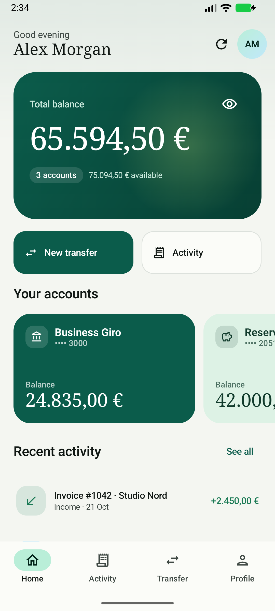
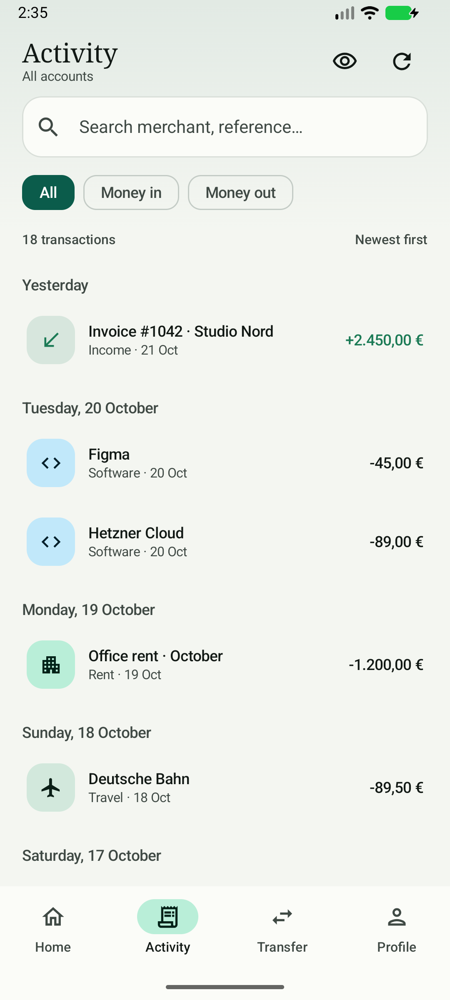
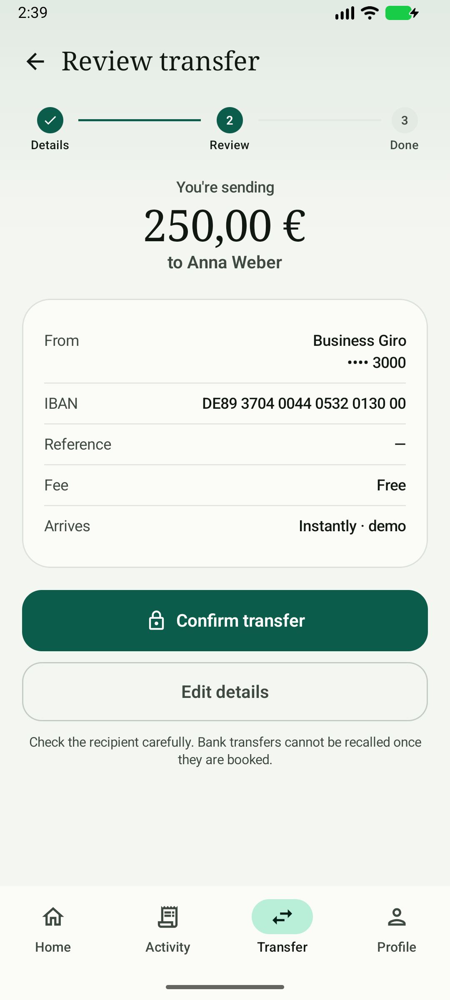
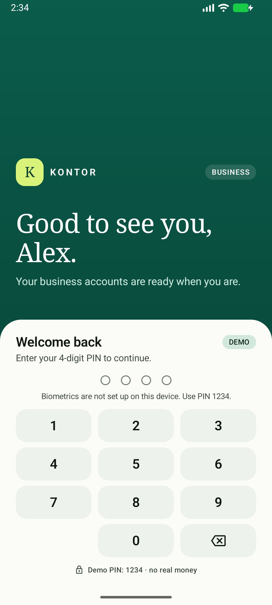
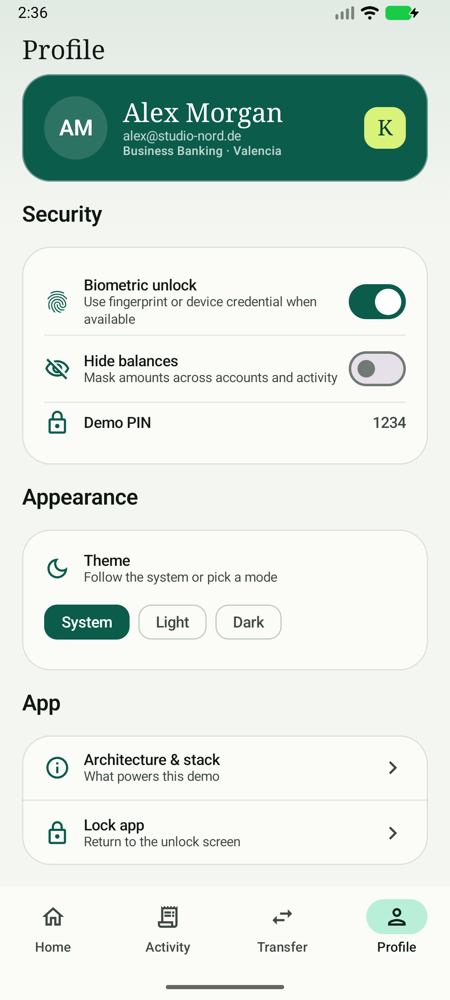
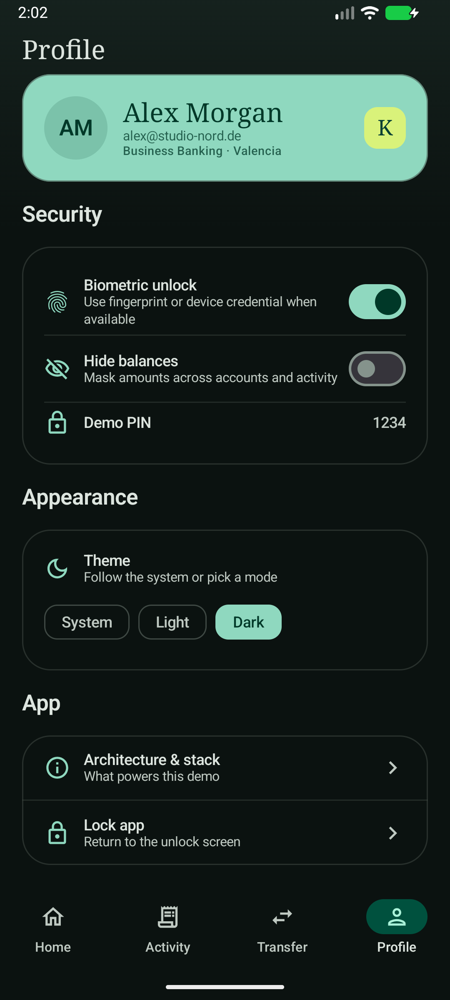
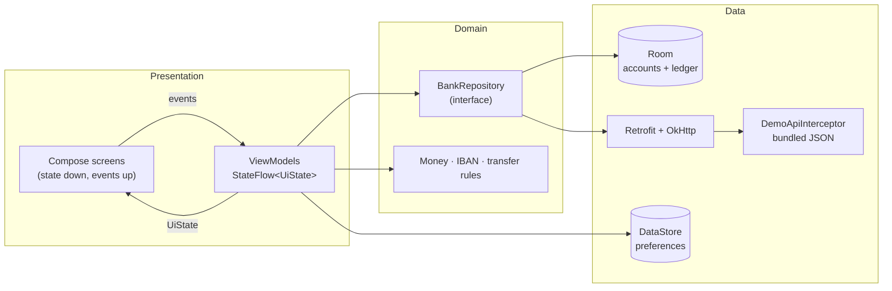

# Kontor

**Small-business banking, built properly.** A production-shaped Android demo that shows accounts, activity and a complete transfer flow — with the architecture, tests and trade-offs explained.

[](https://github.com/rubengmlp/kontor-android/actions/workflows/android.yml)


> Independent portfolio project. **Not affiliated with DKB.** All accounts, IBANs and transactions are fictional. No real money is moved.

## Screens

| Home | Activity | Transfer review |
| --- | --- | --- |
|  |  |  |

| Unlock | Profile | Dark theme |
| --- | --- | --- |
|  |  |  |

More: [transfer form](docs/screenshots/05-transfer-form.png) · [transaction detail](docs/screenshots/04-transaction-detail.png) · [hidden balances](docs/screenshots/10-hidden-balances.png) · [architecture notes](docs/screenshots/11-about.png) · [transfer success](docs/screenshots/07-transfer-success.png)

## What it does

- **Business accounts** — giro, reserve and credit-card accounts with total balance, available funds and a per-account carousel.
- **Activity** — 18 demo transactions, search across counterparty/reference/title, money-in/out filters and day grouping.
- **Transaction detail** — status, category, counterparty, IBAN, reference and an audit-friendly metadata card.
- **Transfers** — beneficiary suggestions, German-style amount entry, ISO 13616 IBAN validation, available-funds checks, review step, success receipt and an atomic local ledger update.
- **Privacy controls** — hide balances from the home and activity screens; the preference is persisted.
- **Unlock gate** — real Android `BiometricPrompt` when the device supports it, with a demo PIN fallback (`1234`).
- **Design system** — Material 3, edge-to-edge insets, light/dark themes, serif display type, accessible touch targets, and feature screens that take their colors from the theme.

## Run it

Requirements: Android Studio (or JDK 21 + Android SDK 36), Android 8.0 (API 26) or newer.

```bash
git clone https://github.com/rubengmlp/kontor-android.git
cd kontor-android
./gradlew installDebug
```

Or open the project in Android Studio and run the `app` configuration.

**Demo PIN: `1234`.** If biometrics are enrolled on the device, the fingerprint/face button is also available. This is a presentation gate, not a cryptographic security boundary — see [Production gaps](#production-gaps).

The debug application id is `com.rubengmlp.kontor.debug`. A debug APK is also uploaded by CI:

```bash
./gradlew assembleDebug
# app/build/outputs/apk/debug/app-debug.apk
```

### Demo data

| Account | Balance | Available | Note |
| --- | ---: | ---: | --- |
| Business Giro · `DE89 3704 0044 0532 0130 00` | €24,835.00 | €24,335.00 | €500 pending-card hold |
| Reserve Account · `DE02 1203 0000 0000 2020 51` | €42,000.00 | €42,000.00 | Savings |
| Business Card · `DE44 5001 0517 5407 3249 31` | −€1,240.50 | €8,759.50 | Available credit line |
| **Total** | **€65,594.50** | **€75,094.50** | Available includes the card credit line |

The app is hermetic: Retrofit and OkHttp are wired for a real REST API, but `DemoApiInterceptor` serves the JSON in `core/data/src/main/assets/demo/`. No backend, emulator DNS or API key is needed. A transfer posts through the interceptor, then updates Room in a transaction and appears immediately in the UI.

## Architecture



**Modules** (dependencies point inward):

```text
:app
 ├── :feature:accounts ─┐
 ├── :feature:transfer ─┼──> :core:designsystem
 ├── :feature:profile ──┘
 ├── :core:data ───────────> :core:domain
 └── :core:designsystem
```

- `:core:domain` is a **pure Kotlin/JVM module**: models, repository contracts, money parsing, IBAN checksum and transfer validation. It has no Android dependency, so its tests are fast and deterministic.
- `:core:data` implements the contracts with Room, Retrofit/OkHttp, DataStore and the demo interceptor. DTOs and Room entities are mapped at this boundary so they never leak into the UI.
- `:core:designsystem` owns the Material 3 theme, typography, shapes and reusable components.
- `:feature:*` modules own a screen, its ViewModel and its tests. They depend on domain and design system, not on each other.
- `:app` is the composition root: Hilt application, navigation, unlock gate and app-level state.

### The important data flow

1. Room is the **single source of truth**. Screens never read the network directly.
2. A ViewModel combines repository `Flow`s (and local UI state) into one immutable `UiState`, exposed as a `StateFlow`.
3. UI events call ViewModel functions; the UI never mutates state.
4. Transfers validate in the domain layer, POST through Retrofit, then update the account balance and insert the ledger entry in one Room `@Transaction`.
5. Room invalidation re-emits the flows, so home and activity update without manual refreshes.

## Tech stack

| Area | Choice |
| --- | --- |
| Language | Kotlin 2.2.21, coroutines 1.10.2, Flow |
| UI | Jetpack Compose BOM 2025.10.01, Material 3, Navigation Compose 2.9.5 |
| Architecture | MVVM + unidirectional data flow, multi-module Clean Architecture |
| DI | Hilt 2.57.2 + KSP |
| Persistence | Room 2.8.3 (schema exported), DataStore Preferences 1.1.7 |
| Network | Retrofit 2.11 + OkHttp 4.12 + kotlinx.serialization 1.9 |
| Auth UI | AndroidX Biometric 1.1.0 |
| Testing | JUnit 4, coroutines-test, Turbine, Compose UI Test, Espresso 3.7 |
| Build | AGP 8.13.1, Gradle 8.13, version catalog, R8, GitHub Actions |

## Engineering decisions

**Money is `Long` cents, never `Double`.** Binary floating point cannot represent 0.10 exactly, and banking code cannot tolerate rounding drift. `Money.parseToCents` accepts German and English input (`1.234,56`, `1234.56`) and `Money.format` uses `NumberFormat` with EUR.

**Balance and available balance are different.** The giro account has a €500 pending-card hold: balance €24,835, available €24,335. Transfers validate against *available*, not balance. The demo also models a credit line, so total available (€75,094.50) can exceed total balance (€65,594.50).

**The transfer is atomic.** `TransferDao.applyTransfer` updates the account and inserts the transaction inside one Room `@Transaction`. A crash between the two writes cannot leave a debit without a ledger entry.

**Offline-first refresh without losing local writes.** The demo API returns seed data. `DefaultBankRepository.refresh()` merges remote accounts by preserving locally known balances, so a refresh does not erase a just-submitted transfer. A production backend would return authoritative balances and use idempotency keys.

**Validation lives in the domain.** `IbanValidator` implements the ISO 13616 mod-97 checksum; `TransferValidator` enforces recipient, IBAN, positive amount, available funds and reference length. Both are unit-tested without Android.

**Navigation is type-safe.** Routes are `@Serializable` objects/data classes (`Home`, `TransactionDetail(id)`, etc.), used with Navigation Compose 2.9's typed APIs instead of string routes.

**Insets are explicit.** The app is edge-to-edge. Screens with a top bar use the shared `KontorTopBar` (which applies status-bar padding); the home screen applies `statusBarsPadding()` to its scroll container. The bottom navigation owns the navigation-bar inset.

**Demo network is isolated.** `DemoApiInterceptor` is wired into the demo Hilt graph. Replacing it with a real base URL is the only step needed to point the app at a backend. The production path still uses OkHttp interceptors, a bearer-token interceptor, timeouts and a JSON converter.

## Project layout

```text
.
├── app/                         # Hilt app, navigation, unlock, status-bar policy
├── core/
│   ├── domain/                  # pure Kotlin models, contracts, money, validation
│   ├── data/                    # Room, Retrofit, DataStore, demo interceptor, mappers
│   └── designsystem/            # Material 3 theme, typography, shared components
├── feature/
│   ├── accounts/                # home, activity, transaction detail
│   ├── transfer/                # form → review → success
│   └── profile/                 # settings, theme, about
├── docs/
│   ├── GUIA_ESTUDIO_ES.md       # Spanish study guide
│   └── screenshots/
└── .github/workflows/android.yml
```

## Tests

| Suite | Tests | What it covers |
| --- | ---: | --- |
| `:core:domain` | 18 | cents formatting/parsing, German and English input, IBAN checksum, transfer validation |
| `:feature:accounts` | 9 | combining balances/transactions, hiding balances, refresh failures, search/filter, detail lookup |
| `:feature:transfer` | 7 | default account, form errors, beneficiary fill, review → success, failure state, reset |
| `:app` instrumentation | 2 | correct PIN unlocks; wrong PIN shows an error and stays locked |
| **Total** | **34 JVM + 2 UI** | |

```bash
./gradlew test                          # all JVM tests
./gradlew :app:connectedDebugAndroidTest # Compose UI tests (needs a running emulator/device)
./gradlew lintDebug assembleRelease      # lint + R8 release build
```

Tests use hand-written fakes and `StandardTestDispatcher`, plus Turbine for `StateFlow` assertions — no MockK, no hidden test framework magic. The ViewModel tests exercise real state transitions and failures.

> `:app` sets `lint.checkTestSources = false` as a workaround for an AGP/Kotlin 2.2 FIR crash while lint resolves Compose UI-test symbols. The instrumentation tests are still executed by `connectedDebugAndroidTest` and by a local emulator check.

## CI/CD

`.github/workflows/android.yml` runs on every push and pull request:

1. JDK 21 + Gradle dependency cache.
2. `lintDebug`, all JVM unit tests and `assembleDebug`.
3. `assembleRelease` to prove R8 shrinking and resource shrinking still work.
4. Uploads the debug APK as a workflow artifact.

## 6-minute demo script

1. **Unlock** — show the biometric option and use PIN `1234`. Mention that real apps would bind the session to a Keystore-backed credential.
2. **Home** — total balance vs available, the pending-card hold, account carousel. Tap the eye to hide balances; it persists.
3. **Activity** — search for `Studio Nord`, filter to money in, open a transaction and show the detail metadata.
4. **Transfer** — choose Anna Weber, enter `250,00`, review, confirm. Show the success receipt and the updated balance/ledger entry on Home.
5. **Profile** — switch to Dark, open “How this app is built”, then lock the app.
6. **Code** — open `DefaultBankRepository.submitTransfer`, `TransferDao.applyTransfer`, `TransferViewModel` and one test. Explain why Room is the source of truth and why the transfer is transactionally consistent.

## Production gaps

This is deliberately a demo. Before a real launch I would add:

- Real authentication/OAuth, token refresh, secure session storage and `FLAG_SECURE`.
- Server-side validation, idempotency keys (`Idempotency-Key`), retry policy and reconciliation for transfers.
- Encrypted database (SQLCipher) or minimized local PII, plus backup/export rules.
- Certificate pinning, root/jailbreak signals and biometric-bound cryptographic keys (not just a UI gate).
- Fraud/velocity/limit checks, SCA/PSD2 flows, audit logging and immutable server-side ledger.
- Pagination, push updates, localization (all demo copy is intentionally inline), accessibility audit and screenshot tests.
- Release signing, Play policy review and real crash/analytics monitoring.

## Spanish study guide

The companion guide [`docs/GUIA_ESTUDIO_ES.md`](docs/GUIA_ESTUDIO_ES.md) explains the project in Spanish: Kotlin, Compose, MVVM, Flow, Hilt, Room, Retrofit, tests, banking-domain decisions, a file-by-file map and likely interview questions.

## License

MIT — see [LICENSE](LICENSE).
